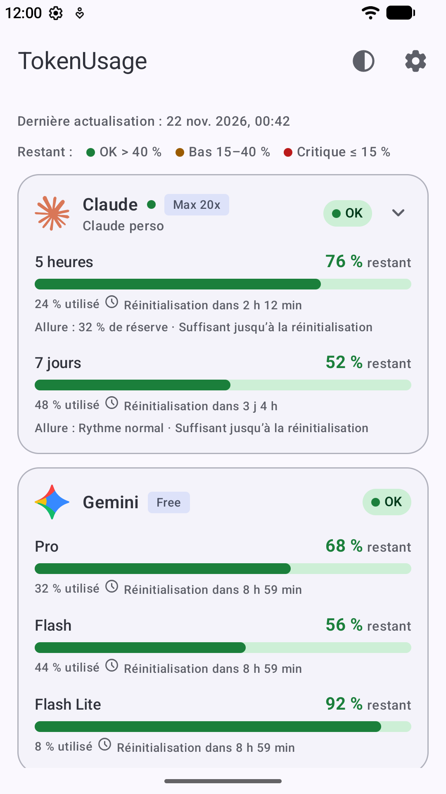
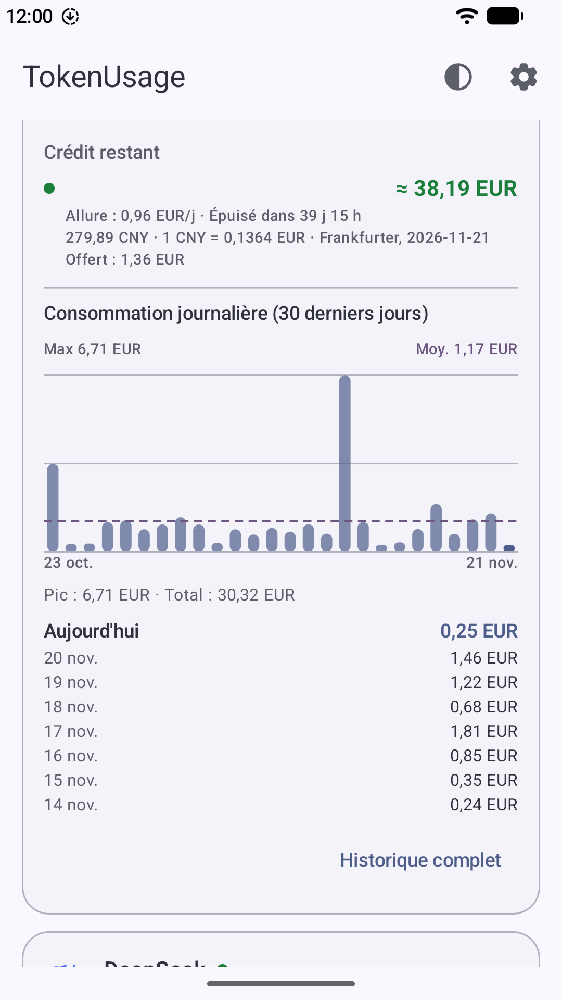
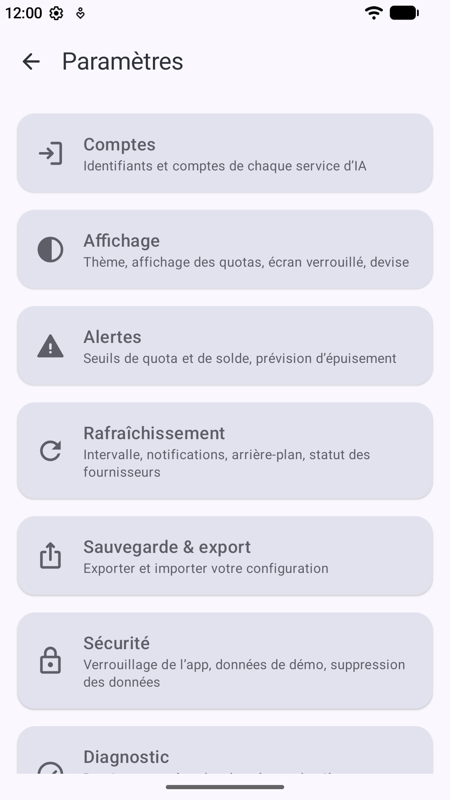
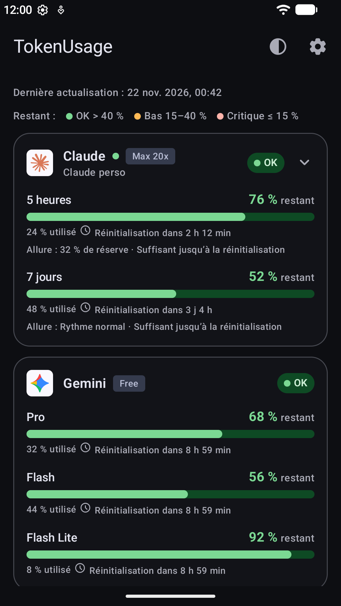

<h1 align="center">TokenUsage</h1>

<p align="center">
  <a href="README.md">English</a> · <b>Français</b> · <a href="README.zh-CN.md">中文</a>
</p>

<p align="center">
  <b>Tous vos quotas IA et soldes d'API, en un coup d'œil.</b><br/>
  DeepSeek · OpenRouter · Z.ai · OpenAI · Claude · Codex · Gemini · GitHub Copilot
</p>

<p align="center">
  <a href="https://github.com/gildas-le-drogoff/TokenUsage/releases/latest"></a>
  
  <a href="LICENSE"></a>
</p>

<p align="center">
  
  
  
  
</p>

---

## ⚡ Collez votre clé d'API. C'est tout.

| Service | Ce qu'il faut | Configuration |
|---|---|---|
| **Claude** | Compte claude.ai | Cliquez **Se connecter avec Claude** |
| **DeepSeek** | Clé d'API | Collez-la → solde + graphiques de consommation jour/mois |
| **OpenRouter** | Clé d'API | Collez-la → crédits restants + dépenses |
| **Z.ai** | Clé d'API | Collez-la → fenêtres de quota + heures de réinitialisation |
| **OpenAI** | Clé d'API Admin | Collez-la → dépenses de l'organisation |
| **GitHub Copilot** | Compte GitHub | Cliquez **Se connecter avec GitHub**, saisissez le code d'appareil |
| **Codex** / **Gemini** | Jetons de la CLI | Quelques valeurs à copier, [voir plus bas](#avancé--codex-et-gemini) |

Ouvrez les **Paramètres**, renseignez les services que vous utilisez, et votre tableau de bord est prêt. Pas de compte, pas de serveur, pas d'inscription.

## ✨ Pourquoi vous allez l'adorer

- 🎯 **Tout sur un seul tableau de bord** : quotas, soldes prépayés et dépenses de 8 fournisseurs
- 🚦 **Lecture immédiate** : vert, orange, rouge, avec l'heure de réinitialisation de chaque fenêtre de quota
- 👥 **Plusieurs comptes** pour Claude, Z.ai et DeepSeek
- 📈 **Historique de consommation** pour DeepSeek, jour par jour et mois par mois
- 💱 **Votre devise** : gardez celle de chaque fournisseur ou convertissez tout en USD, EUR ou CNY
- 📱 **Widgets d'écran d'accueil** et **tuile de Réglages rapides**
- 🔔 **Notifications** à la réinitialisation d'un quota
- 🔒 **Verrouillage de l'app** (biométrie), **stockage chiffré**, **sauvegarde chiffrée** (ZIP ou QR code)
- 🌗 Material 3, thèmes clair et sombre, téléphones et tablettes — en anglais, français et chinois

## 🛡️ Confidentiel par conception

Pas de serveur. Pas d'analytics. Pas de pistage. Vos clés sont chiffrées sur l'appareil (Android Keystore) et ne sont envoyées qu'au fournisseur auquel elles appartiennent. La seule autre requête concerne les taux de change (Frankfurter ou BCE), et uniquement si vous la choisissez.

## 📥 Installation

Téléchargez l'APK depuis la [dernière version](https://github.com/gildas-le-drogoff/TokenUsage/releases/latest). Android 10 ou ultérieur requis.

---

## Avancé : Codex et Gemini

Ces deux services n'ont pas de simple clé d'API : les jetons proviennent de leurs outils en ligne de commande.

<details>
<summary><b>Codex (ChatGPT)</b></summary>

Avec la [CLI Codex](https://github.com/openai/codex) installée et connectée :

```bash
python3 -c "import json; t=json.load(open('$HOME/.codex/auth.json'))['tokens']; print('Access: ', t['access_token']); print('Refresh:', t['refresh_token'])"
```

Collez les deux valeurs dans les champs Codex des Paramètres.

Pas de CLI ? Ouvrez [chatgpt.com](https://chatgpt.com), les outils de développement (F12) → Réseau, trouvez une requête vers `backend-api/` et copiez le jeton `Authorization: Bearer …`.

</details>

<details>
<summary><b>Gemini (Google)</b></summary>

Gemini demande 4 valeurs : jeton d'accès, jeton de rafraîchissement, ID client et secret OAuth (utilisés pour rafraîchir le jeton). Avec la [CLI Gemini](https://github.com/google-gemini/gemini-cli) installée et connectée :

```bash
# Jetons d'accès et de rafraîchissement
python3 -c "import json; c=json.load(open('$HOME/.gemini/oauth_creds.json')); print('Access: ', c['access_token']); print('Refresh:', c['refresh_token'])"

# ID client et secret OAuth (tirés du code source de la CLI Gemini)
oauth_js="$(dirname "$(which gemini)")/../lib/node_modules/@google/gemini-cli/node_modules/@google/gemini-cli-core/dist/src/code_assist/oauth2.js"
grep -oE "OAUTH_CLIENT_(ID|SECRET) *= *'[^']+'" "$oauth_js"
```

Collez les quatre valeurs dans les champs Gemini des Paramètres.

</details>

## Compiler depuis les sources

Nécessite le JDK 25 et le SDK Android.

```bash
./gradlew assembleDebug     # build debug, avec des données d'exemple pour prévisualiser l'interface
./gradlew assembleRelease   # build release (signé si keystore.properties est présent)
./generate-screenshots.sh   # captures pour les stores, depuis un émulateur exécutant le build debug
```

Les builds release sont reproductibles : un build non signé d'un commit tagué correspond octet pour octet à l'APK publié, signature mise à part.

## Remerciements

Portage Android de [**CodexBar**](https://github.com/steipete/CodexBar) de [@steipete](https://github.com/steipete), l'app de barre de menus macOS, basé sur [codexbar-android](https://github.com/hyunnnchoi/codexbar-android) de hyunnnchoi.

## Licence

Copyright (C) 2026 Gildas Le Drogoff — [GPL-3.0-or-later](LICENSE).

Fork de [codexbar-android](https://github.com/hyunnnchoi/codexbar-android) (MIT, copyright (c) 2026 hyunnnchoi ; notice conservée dans [LICENSE-MIT](LICENSE-MIT)). Les composants tiers gardent leur propre licence : wrapper Gradle ([Apache-2.0](LICENSES/Apache-2.0.txt)), icônes de marques de [Simple Icons](https://simpleicons.org/) ([CC0-1.0](LICENSES/CC0-1.0.txt)). Les métadonnées de licence suivent la [spécification REUSE](https://reuse.software/spec/) dans [`REUSE.toml`](REUSE.toml) ; vérification avec `reuse lint`.
