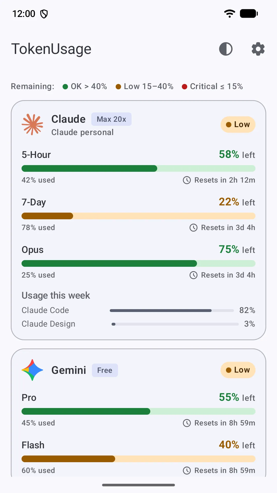
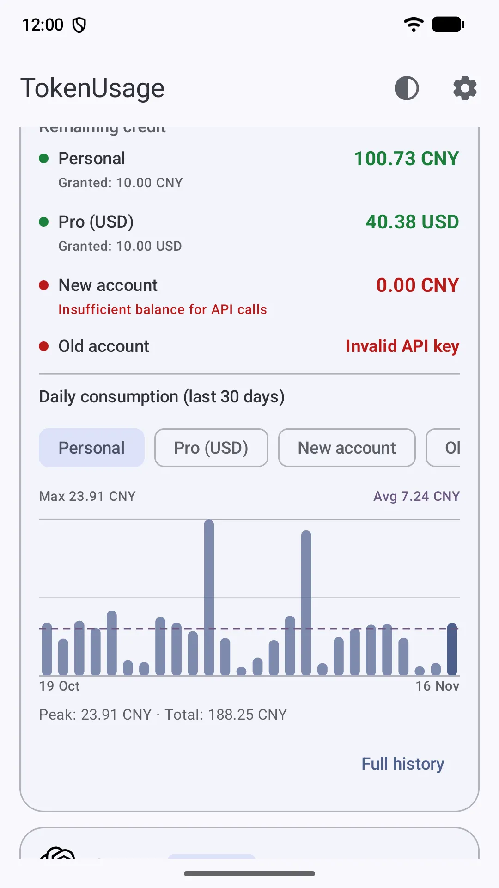
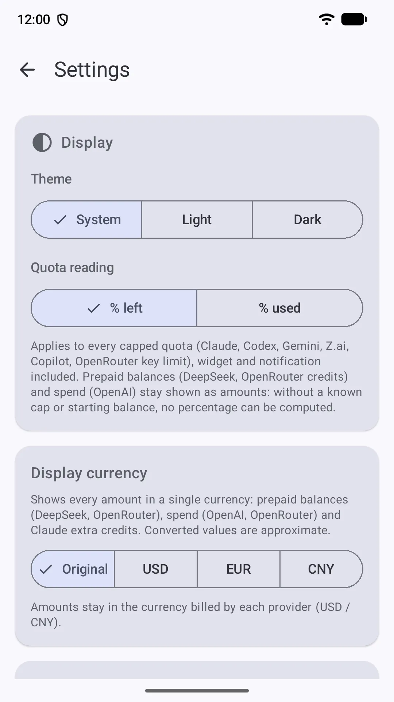
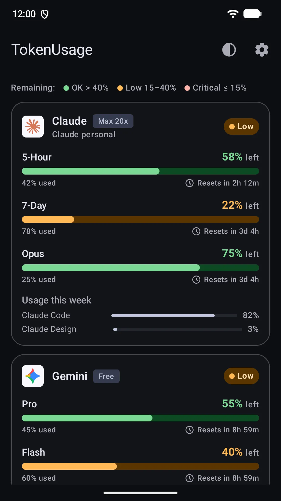

# TokenUsage

Track your AI subscription quotas and API balances from your Android device — Claude, Codex (ChatGPT), Gemini, GitHub Copilot, Z.ai, DeepSeek, OpenRouter and OpenAI in one dashboard.

> Android port of [**CodexBar**](https://github.com/steipete/CodexBar) by [@steipete](https://github.com/steipete), the macOS menu bar app for monitoring AI service quotas, based on [codexbar-android](https://github.com/hyunnnchoi/codexbar-android) by hyunnnchoi.

<p align="center">
  
  
  
  
</p>

## Features

- **Eight services in one place**: Claude, Codex, Gemini, GitHub Copilot and Z.ai quotas; DeepSeek and OpenRouter prepaid balances; OpenAI and OpenRouter spend
- **Multiple accounts** per service for Claude, Z.ai and DeepSeek
- **One colour code everywhere**: green above 40 % left, amber between 15 and 40 %, red at 15 % or below, with the reset time of every quota window
- **"% left" or "% used"** reading, your choice
- **Display currency**: keep the currency billed by each provider or convert every amount to USD, EUR or CNY (manual rate, Frankfurter or ECB)
- **Consumption history** for DeepSeek: daily and monthly charts built from the balance recorded at each refresh
- **Home screen widgets** (quotas, compact quota, next reset, balances) and a **Quick Settings tile**
- **Notifications**: quota status and an alert when a quota resets
- **Background refresh** at the interval you choose
- **App lock** with biometrics or the device screen lock
- **Encrypted storage**: credentials encrypted with a key held in the Android Keystore, history in an encrypted database
- **Encrypted backup** protected by a PIN, as a ZIP file or a QR code
- Material 3, light and dark themes, adaptive layout for phones and tablets
- Available in English, French and Chinese

## Privacy

There is no backend server and no analytics. Credentials are stored encrypted on the device and are only sent to the provider they belong to. The only other network requests are exchange rates from Frankfurter or the ECB, if you select one of them as the rate source.

## Requirements

Android 10 (API 29) or later.

## Getting Your Tokens

Open **Settings** in the app and fill in the services you use.

- **DeepSeek, OpenRouter, Z.ai**: paste an API key created in the provider's console.
- **OpenAI**: paste an Admin API key (spend is read from the organization usage API).
- **GitHub Copilot**: sign in from Settings with the GitHub device code shown by the app.
- **Claude, Codex, Gemini**: see below.

> **Claude: prefer "Sign in with Claude" or a Session Key.** Anthropic rotates OAuth refresh tokens on every use, so tokens copied from the Claude CLI stop working as soon as the CLI refreshes its own copy. In Settings → Claude, sign in with Claude or paste the claude.ai `sessionKey` cookie (`sk-ant-sid…`) instead; it does not rotate.

### Claude (Anthropic)

Claude uses OAuth tokens from Claude Code CLI. Extract both tokens from macOS Keychain:

```bash
security find-generic-password -s "Claude Code-credentials" -w \
  | python3 -c "
import sys, json
d = json.loads(sys.stdin.read())['claudeAiOauth']
print('Access Token:', d['accessToken'])
print('Refresh Token:', d['refreshToken'])
"
```

Paste **both** tokens into the Claude fields in Settings. The refresh token is required — access tokens expire every 8 hours, and the app uses the refresh token to renew them automatically in the background.

### Codex (OpenAI / ChatGPT)

If you have the [Codex CLI](https://github.com/openai/codex) installed and logged in, extract tokens from `~/.codex/auth.json`:

```bash
# Access token
cat ~/.codex/auth.json | python3 -c "import sys,json; print(json.loads(sys.stdin.read())['tokens']['access_token'])"

# Refresh token
cat ~/.codex/auth.json | python3 -c "import sys,json; print(json.loads(sys.stdin.read())['tokens']['refresh_token'])"
```

Paste both into the Codex fields in Settings.

<details>
<summary>Alternative: Extract from browser (if CLI is not installed)</summary>

1. Open [chatgpt.com](https://chatgpt.com) in your browser
2. Open DevTools (F12) > Network tab
3. Look for requests to `https://chatgpt.com/backend-api/`
4. Copy the `Authorization: Bearer ...` token from request headers

</details>

### Gemini (Google)

Gemini requires **4 values**: access token, refresh token, OAuth client ID, and OAuth client secret. The client ID/secret are needed because Gemini uses Google OAuth for token refresh.

If you have the [Gemini CLI](https://github.com/google-gemini/gemini-cli) installed and logged in:

```bash
# 1. Access token
python3 -c "import json; print(json.load(open('$HOME/.gemini/oauth_creds.json'))['access_token'])"

# 2. Refresh token
python3 -c "import json; print(json.load(open('$HOME/.gemini/oauth_creds.json'))['refresh_token'])"

# 3. OAuth Client ID & Secret (from Gemini CLI source)
oauth_js="$(dirname "$(which gemini)")/../lib/node_modules/@google/gemini-cli/node_modules/@google/gemini-cli-core/dist/src/code_assist/oauth2.js"
python3 -c "
import re, sys
text = open('$oauth_js').read()
cid = re.search(r\"OAUTH_CLIENT_ID\s*=\s*'([^']+)'\", text)
sec = re.search(r\"OAUTH_CLIENT_SECRET\s*=\s*'([^']+)'\", text)
print('Client ID:', cid.group(1) if cid else 'not found')
print('Client Secret:', sec.group(1) if sec else 'not found')
"
```

Paste all four values into the Gemini fields in Settings.


## Build

Requires JDK 25 and the Android SDK.

```bash
./gradlew assembleDebug     # debug build, ships sample data to review the UI
./gradlew assembleRelease   # release build (needs keystore.properties to be signed)
```

One universal APK is produced per build type in `app/build/outputs/apk/`. Release builds are reproducible: an unsigned build of a tagged commit matches the published APK byte for byte, signature aside.

Store screenshots are generated from an emulator running the debug build:

```bash
./generate-screenshots.sh
```

## Acknowledgments

- [CodexBar](https://github.com/steipete/CodexBar) by Peter Steinberger, the original macOS app
- [codexbar-android](https://github.com/hyunnnchoi/codexbar-android) by hyunnnchoi, the Android port this project is based on

## License

Copyright (C) 2026 Gildas Le Drogoff

This program is free software: you can redistribute it and/or modify it under the terms of the GNU General Public License as published by the Free Software Foundation, either version 3 of the License, or (at your option) any later version. See [LICENSE](LICENSE).

This project is a fork of [codexbar-android](https://github.com/hyunnnchoi/codexbar-android), copyright (c) 2026 hyunnnchoi, released under the MIT License. That notice is kept in [LICENSE-MIT](LICENSE-MIT) and still applies to the original code.

### REUSE / SPDX

Licensing and copyright metadata is maintained machine-readably in [`REUSE.toml`](REUSE.toml), following the [REUSE specification](https://reuse.software/spec/) (SPDX format). Verify compliance with `reuse lint`; license texts live in [`LICENSES/`](LICENSES/).

Third-party components keep their own licenses: the Gradle wrapper ([Apache-2.0](LICENSES/Apache-2.0.txt)), and brand icons from [Simple Icons](https://simpleicons.org/) ([CC0-1.0](LICENSES/CC0-1.0.txt)).
