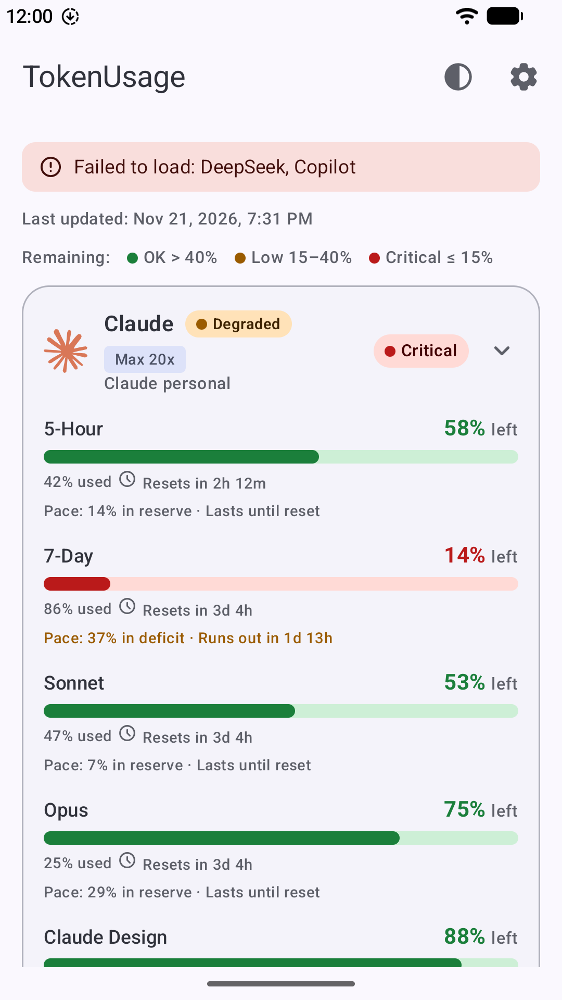
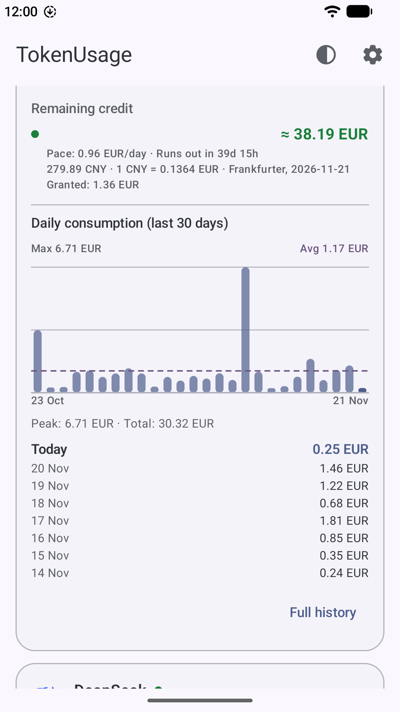
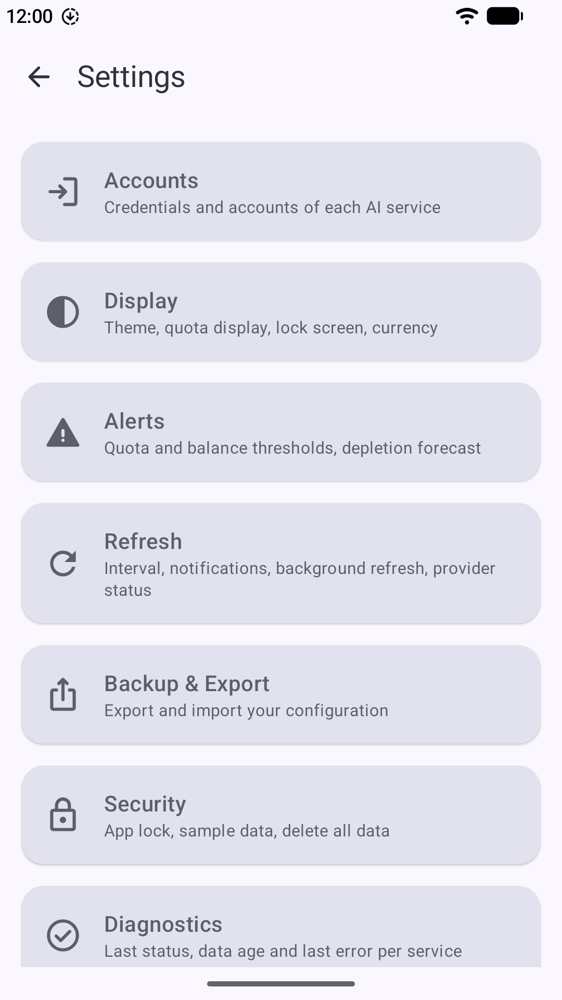
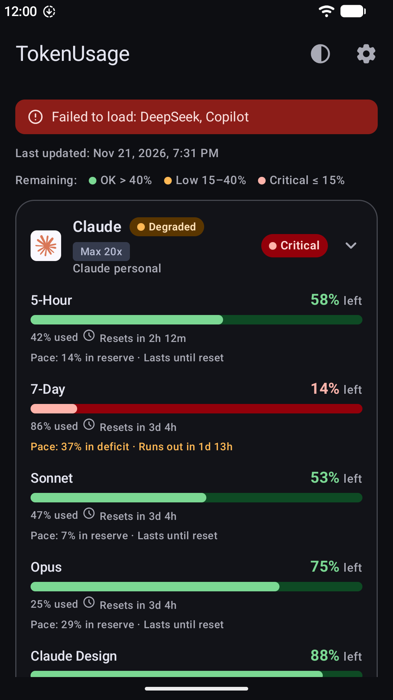

<h1 align="center">TokenUsage</h1>

<p align="center">
  <b>English</b> · <a href="README.fr.md">Français</a> · <a href="README.zh-CN.md">中文</a>
</p>

<p align="center">
  <b>AI quotas and API balances in one place.</b><br/>
  DeepSeek · OpenRouter · Z.ai · OpenAI · Claude · Codex · Gemini · GitHub Copilot
</p>

<p align="center">
  <a href="https://github.com/gildas-le-drogoff/TokenUsage/releases/latest"></a>
  
  <a href="LICENSE"></a>
</p>

<p align="center">
  
  
  
  
</p>

---

## Getting started

| Service | What you need | Setup |
|---|---|---|
| **Claude** | claude.ai account | Tap **Sign in with Claude** |
| **Claude API** | platform.claude.com session cookie | Paste it → API credit balance + monthly spend |
| **DeepSeek** | API key | Paste it → balance + daily/monthly consumption charts |
| **OpenRouter** | API key | Paste it → credits left + spend |
| **Z.ai** | API key | Paste it → quota windows + reset times |
| **OpenAI** | Admin API key | Paste it → organization spend |
| **GitHub Copilot** | GitHub account | Tap **Sign in with GitHub**, enter the device code |
| **Codex** / **Gemini** | CLI tokens | A few values to copy, [see below](#advanced-codex--gemini) |

Open **Settings**, fill in the services you use, and your dashboard is ready. No account, no server, no sign-up.

## ✨ Features

- **One dashboard**: quotas, prepaid balances and spend from 8 providers
- **Instant reading**: green, amber, red, with the reset time of every quota window
- **Multiple accounts** for every service
- **Consumption history** for DeepSeek, day by day and month by month
- **Your currency**: keep each provider's currency or convert everything to USD, EUR or CNY
- **Home screen widgets** and a **Quick Settings tile**
- **Notifications** when a quota resets, and **configurable alerts** (quota threshold, low balance, depletion forecast)
- **App lock** (biometrics), **encrypted storage**, **encrypted backup** (ZIP or QR code)
- Material 3, light & dark themes, phones and tablets — in English, French and Chinese

## 🛡️ Privacy

No backend. No analytics. No tracking. Your keys are encrypted on the device (Android Keystore) and only ever sent to the provider they belong to. The only other request is for exchange rates (Frankfurter or ECB), and only if you choose one.

## 📥 Install

Grab the APK from the [latest release](https://github.com/gildas-le-drogoff/TokenUsage/releases/latest). Requires Android 10 or later.

---

## Advanced: Codex & Gemini

These two services have no simple API key, so the tokens come from their command-line tools.

<details>
<summary><b>Codex (ChatGPT)</b></summary>

With the [Codex CLI](https://github.com/openai/codex) installed and logged in:

```bash
python3 -c "import json; t=json.load(open('$HOME/.codex/auth.json'))['tokens']; print('Access: ', t['access_token']); print('Refresh:', t['refresh_token'])"
```

Paste both values into the Codex fields in Settings.

No CLI? Open [chatgpt.com](https://chatgpt.com), DevTools (F12) → Network, find a request to `backend-api/` and copy the `Authorization: Bearer …` token.

</details>

<details>
<summary><b>Gemini (Google)</b></summary>

Gemini needs 4 values: access token, refresh token, OAuth client ID and secret (used to refresh the token). With the [Gemini CLI](https://github.com/google-gemini/gemini-cli) installed and logged in:

```bash
# Access & refresh tokens
python3 -c "import json; c=json.load(open('$HOME/.gemini/oauth_creds.json')); print('Access: ', c['access_token']); print('Refresh:', c['refresh_token'])"

# OAuth client ID & secret (from the Gemini CLI source)
oauth_js="$(dirname "$(which gemini)")/../lib/node_modules/@google/gemini-cli/node_modules/@google/gemini-cli-core/dist/src/code_assist/oauth2.js"
grep -oE "OAUTH_CLIENT_(ID|SECRET) *= *'[^']+'" "$oauth_js"
```

Paste the four values into the Gemini fields in Settings.

</details>

## Build from source

Requires JDK 25 and the Android SDK.

```bash
./gradlew assembleDebug     # debug build, with sample data to preview the UI
./gradlew assembleRelease   # release build (signed if keystore.properties is present)
./generate-screenshots.sh   # store screenshots, from an emulator running the debug build
```

Release builds are reproducible: an unsigned build of a tagged commit matches the published APK byte for byte, signature aside.

## Credits

Android port of [**CodexBar**](https://github.com/steipete/CodexBar) by [@steipete](https://github.com/steipete), the macOS menu bar app, based on [codexbar-android](https://github.com/hyunnnchoi/codexbar-android) by hyunnnchoi.

## License

Copyright (C) 2026 Gildas Le Drogoff — [GPL-3.0-or-later](LICENSE).

Forked from [codexbar-android](https://github.com/hyunnnchoi/codexbar-android) (MIT, copyright (c) 2026 hyunnnchoi; notice kept in [LICENSE-MIT](LICENSE-MIT)). Third-party components keep their own licenses: Gradle wrapper ([Apache-2.0](LICENSES/Apache-2.0.txt)), brand icons from [Simple Icons](https://simpleicons.org/) ([CC0-1.0](LICENSES/CC0-1.0.txt)). Licensing metadata follows the [REUSE specification](https://reuse.software/spec/) in [`REUSE.toml`](REUSE.toml); check with `reuse lint`.
