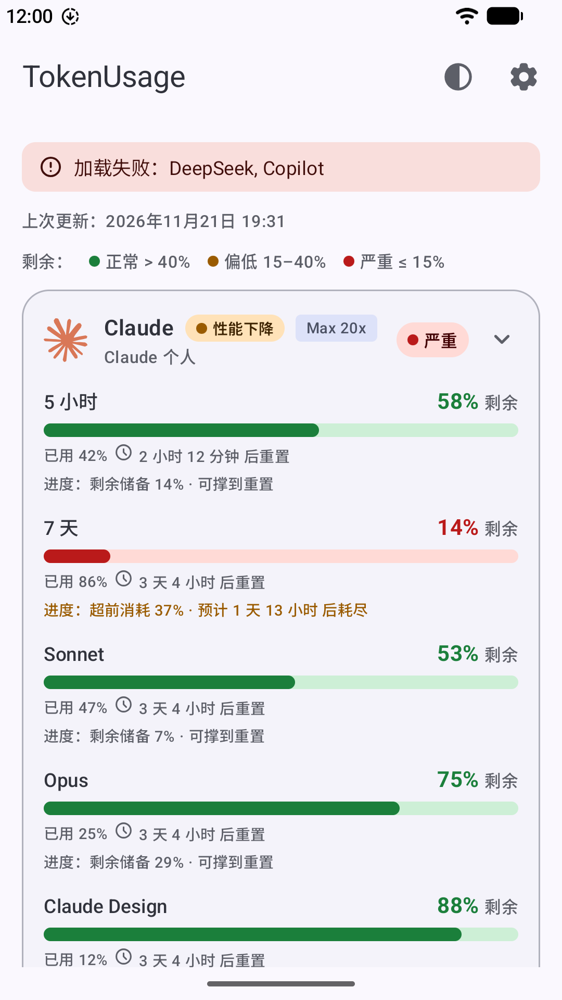
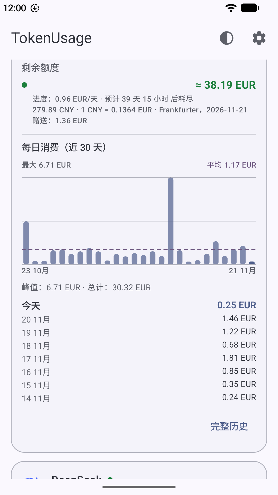
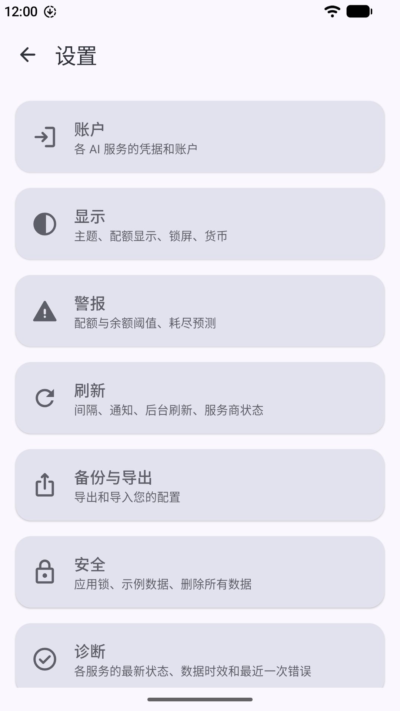
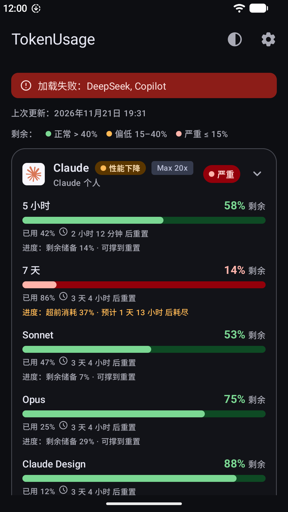

<h1 align="center">TokenUsage</h1>

<p align="center">
  <a href="README.md">English</a> · <a href="README.fr.md">Français</a> · <b>中文</b>
</p>

<p align="center">
  <b>AI 配额与 API 余额，集中查看。</b><br/>
  DeepSeek · OpenRouter · Z.ai · OpenAI · Claude · Codex · Gemini · GitHub Copilot
</p>

<p align="center">
  <a href="https://github.com/gildas-le-drogoff/TokenUsage/releases/latest"></a>
  
  <a href="LICENSE"></a>
</p>

<p align="center">
  
  
  
  
</p>

---

## 快速上手

| 服务 | 所需条件 | 配置方式 |
|---|---|---|
| **Claude** | claude.ai 账号 | 点击 **使用 Claude 登录** |
| **Claude API** | platform.claude.com 会话 Cookie | 粘贴即可 → API 额度余额 + 当月支出 |
| **DeepSeek** | API 密钥 | 粘贴即可 → 余额 + 每日/每月消费图表 |
| **OpenRouter** | API 密钥 | 粘贴即可 → 剩余额度 + 支出 |
| **Z.ai** | API 密钥 | 粘贴即可 → 配额窗口 + 重置时间 |
| **OpenAI** | Admin API 密钥 | 粘贴即可 → 组织支出 |
| **GitHub Copilot** | GitHub 账号 | 点击 **使用 GitHub 登录**，输入设备代码 |
| **Codex** / **Gemini** | CLI 令牌 | 需复制几个值，[见下文](#高级codex-与-gemini) |

打开 **设置**，填写你使用的服务，仪表盘即刻就绪。无需账号，无需服务器，无需注册。

## ✨ 功能

- **统一仪表盘**：8 家服务商的配额、预付余额和支出
- **一眼读懂**：绿、黄、红三色，并显示每个配额窗口的重置时间
- 所有服务均支持 **多账号**
- DeepSeek **消费历史**，按日、按月查看
- **你的货币**：保留各服务商的原始货币，或统一换算为 USD、EUR 或 CNY
- **主屏幕小部件** 和 **快速设置磁贴**
- 配额重置时发送 **通知**，并支持 **可配置提醒**（配额阈值、余额不足、耗尽预测）
- **应用锁**（生物识别）、**加密存储**、**加密备份**（ZIP 或二维码）
- Material 3，浅色与深色主题，适配手机和平板 — 支持英文、法文和中文

## 🛡️ 隐私

没有后端。没有统计分析。没有跟踪。你的密钥在设备上加密存储（Android Keystore），只会发送给其所属的服务商。唯一的其他请求是获取汇率（Frankfurter 或欧洲央行），且仅在你选择启用时才会发出。

## 📥 安装

从 [最新发布版本](https://github.com/gildas-le-drogoff/TokenUsage/releases/latest) 下载 APK。需要 Android 10 或更高版本。

---

## 高级：Codex 与 Gemini

这两项服务没有简单的 API 密钥，因此令牌需从它们的命令行工具中获取。

<details>
<summary><b>Codex (ChatGPT)</b></summary>

在已安装并登录 [Codex CLI](https://github.com/openai/codex) 的情况下：

```bash
python3 -c "import json; t=json.load(open('$HOME/.codex/auth.json'))['tokens']; print('Access: ', t['access_token']); print('Refresh:', t['refresh_token'])"
```

将这两个值粘贴到设置中的 Codex 字段。

没有 CLI？打开 [chatgpt.com](https://chatgpt.com)，开发者工具（F12）→ 网络，找到一个发往 `backend-api/` 的请求，复制 `Authorization: Bearer …` 令牌。

</details>

<details>
<summary><b>Gemini (Google)</b></summary>

Gemini 需要 4 个值：访问令牌、刷新令牌、OAuth 客户端 ID 和密钥（用于刷新令牌）。在已安装并登录 [Gemini CLI](https://github.com/google-gemini/gemini-cli) 的情况下：

```bash
# 访问令牌和刷新令牌
python3 -c "import json; c=json.load(open('$HOME/.gemini/oauth_creds.json')); print('Access: ', c['access_token']); print('Refresh:', c['refresh_token'])"

# OAuth 客户端 ID 和密钥（取自 Gemini CLI 源码）
oauth_js="$(dirname "$(which gemini)")/../lib/node_modules/@google/gemini-cli/node_modules/@google/gemini-cli-core/dist/src/code_assist/oauth2.js"
grep -oE "OAUTH_CLIENT_(ID|SECRET) *= *'[^']+'" "$oauth_js"
```

将这四个值粘贴到设置中的 Gemini 字段。

</details>

## 从源码构建

需要 JDK 25 和 Android SDK。

```bash
./gradlew assembleDebug     # debug 构建，附带示例数据用于预览界面
./gradlew assembleRelease   # release 构建（若存在 keystore.properties 则会签名）
./generate-screenshots.sh   # 应用商店截图，需在运行 debug 构建的模拟器上执行
```

Release 构建可复现：对已打标签的提交进行未签名构建，除签名外与发布的 APK 逐字节一致。

## 致谢

本项目是 [@steipete](https://github.com/steipete) 开发的 macOS 菜单栏应用 [**CodexBar**](https://github.com/steipete/CodexBar) 的 Android 移植版，基于 hyunnnchoi 的 [codexbar-android](https://github.com/hyunnnchoi/codexbar-android)。

## 许可证

Copyright (C) 2026 Gildas Le Drogoff — [GPL-3.0-or-later](LICENSE)。

派生自 [codexbar-android](https://github.com/hyunnnchoi/codexbar-android)（MIT，copyright (c) 2026 hyunnnchoi；声明保留于 [LICENSE-MIT](LICENSE-MIT)）。第三方组件保留各自的许可证：Gradle wrapper（[Apache-2.0](LICENSES/Apache-2.0.txt)），品牌图标来自 [Simple Icons](https://simpleicons.org/)（[CC0-1.0](LICENSES/CC0-1.0.txt)）。许可元数据遵循 [REUSE 规范](https://reuse.software/spec/)，见 [`REUSE.toml`](REUSE.toml)；可使用 `reuse lint` 检查。
